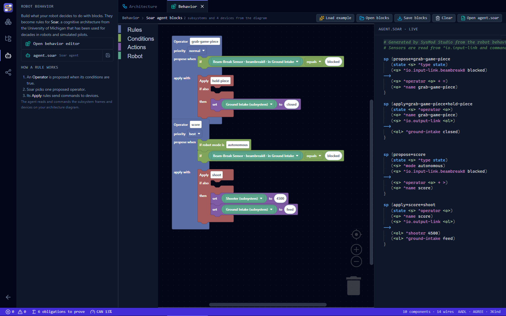
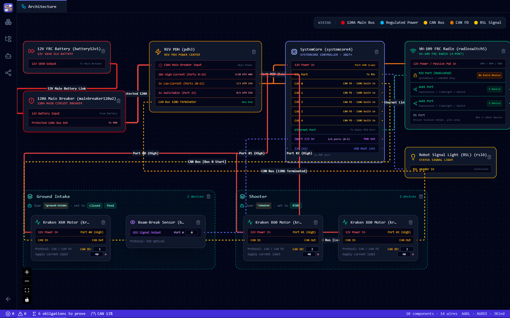
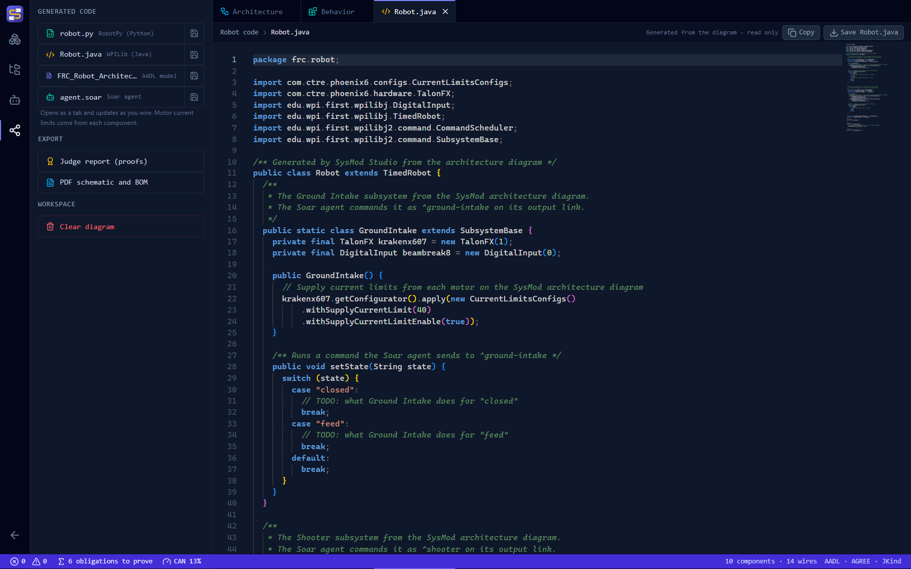

# Robot Behavior with Soar

The **Behavior** editor lets you describe what your robot decides to do, by snapping blocks together. The blocks become rules for **Soar**, a cognitive architecture developed at the University of Michigan. Soar has been used for decades to build intelligent agents, from robots to simulated pilots, so the rules students write here are the same kind professionals write.

The editor started as the separate [SoarBlocks](https://github.com/Suave101/SoarBlocks) project and is now part of SysMod Studio.

## Opening it

On the Architecture page, select **Behavior** in the activity bar, then **Open behavior editor**. Blocks are on the left. The Soar rules they generate update live on the right.

To get started, select **Load example**. It builds a small program from your own robot: when a sensor sees a game piece, set a subsystem to `closed`.



## Subsystems

A subsystem is a part of the robot with one job, like an intake, an arm or a drivetrain. Nothing is built in: you draw your own on the architecture diagram.

1. In the **Components** side bar, under **Subsystems**, select **Subsystem frame**. If you listed subsystems on the Brainstorming page, **Add from Brainstorming** makes a frame for each one.
2. Click the frame's name to rename it, such as `Ground Intake`. Drag its corners to resize it.
3. Drag motors, sensors and pneumatics into the frame. A device belongs to the subsystem its center is dropped in. Drag it out to remove it.



Deleting a frame keeps its devices on the diagram. Frames aren't hardware, so rule checks, contracts, proofs and the BOM ignore them.

Each subsystem shows up in three places:

| Where | What it becomes |
|---|---|
| **Behavior editor** | A choice in the **device** block, such as `Ground Intake (subsystem)`. In Soar it is `^ground-intake`. |
| **Robot.java / robot.py** | A subsystem class, such as `GroundIntake`, that creates the devices in its frame. Its `setState` method (`set_state` in Python) has one case for each value the Soar agent sets it to, ready for you to fill in. |
| **AADL model** | A comment on each device naming its subsystem, plus a list of subsystems. Wires still connect devices directly, so contracts and proofs don't change. |

The frame shows its Soar name and the commands the agent sends it, such as `set to closed`. Renaming a subsystem also updates the behavior blocks that use it.

In `Robot.java`, the Ground Intake frame above becomes this class, with a `case` for each command:



## How Soar decides

Soar repeats a short decision cycle many times a second:

1. **Propose:** every **Operator** whose conditions are true is proposed.
2. **Decide:** Soar picks one proposed operator, using each operator's **priority**.
3. **Apply:** the chosen operator's **Apply** rules run, sending commands to devices.

**Elaborate** rules are different: they run whenever their conditions are true, without being chosen, so they're good for facts like "a game piece is ready".

An operator stays chosen while its conditions are true, and keeps sending its commands. Each time the robot finishes one, the agent clears it and the operator sends it again, so "set the intake to `closed`" means *keep* the intake closed while the beam break is blocked. An **Elaborate** rule sends its command once each time its conditions become true.

When two operators are proposed, **priority** decides: best beats normal, normal beats worst, and required beats everything. Among operators with the same priority, Soar picks one at random each time. When nothing is proposed, the agent waits.

## The blocks

| Group | Block | What it does |
|---|---|---|
| **Rules** | **Operator** | Proposes an action when its conditions are true. Its **priority** is normal, best, worst or required. |
| | **Apply** | Goes inside an Operator. Runs when that operator is chosen, if its extra conditions are true. |
| | **Elaborate** | Adds facts or sends commands whenever its conditions are true |
| **Conditions** | **if** | True when a device reports a value: equals, does not equal, is greater than or is less than |
| | **if not** | True when a device does *not* report that value |
| | **if robot mode is** | True in a Driver Station mode: `disabled`, `autonomous`, `teleop` or `test` |
| **Actions** | **set** | Sends a command to a device, such as setting the claw to `closed` |
| | **remember / forget** | Adds or removes a fact in the agent's own memory |
| **Robot** | **device** | A subsystem or device on your robot |
| | **value** | A value, such as `open`, `true` or `4500` |

The **device** block lists the subsystem frames on your architecture diagram, then the motors, servos, pneumatics, sensors and cameras on it. Devices in a frame are marked, such as `Beam-Break Sensor · beambreak2 · in Ground Intake`. With an empty diagram, the only choice says to add a subsystem. If you delete a subsystem or device from the diagram, blocks that use it keep its name and mark it **(not on diagram)**, so your rules aren't changed behind your back.

Right-click a block to **collapse** it, add a **comment**, disable it, or delete it. Disabled blocks are left out of the agent.

## Saving and opening blocks

The editor doesn't save to disk on its own yet, so use **Save blocks** to keep your work. It writes a `behavior.json` file. **Open blocks** loads one back.

**Open blocks** also reads files from SoarBlocks and other Blockly tools, in JSON or XML. SoarBlocks had a separate **preference** block. Here, priority is a choice on the **Operator** block instead, so opening a SoarBlocks file moves each preference onto the Operator it names:

| SoarBlocks preference | Operator priority |
|---|---|
| Acceptable (+) | normal |
| Better (>) | best |
| Worse (<) | worst |
| Require (!) | required |
| Reject (-) | none. The block stays on the canvas. |

A preference that can't move stays on the canvas as an **old preference** block. It does nothing, and says to use the Operator's priority instead. A note above the blocks lists what changed.

## The generated agent

The rules are saved as `agent.soar`. Open it from the editor, from the Behavior side bar, or from **Export & Project → Generated code**. Like the robot code, it is read only and updates as you edit.

Sensors are read from Soar's `^io.input-link`, and commands are written to `^io.output-link`, the standard way Soar agents connect to the world. For example, the example program generates:

```soar
sp {propose*grab-game-piece
   (state <s> ^superstate nil)
   (<s> ^io.input-link.beambreak1 blocked)
-->
   (<s> ^operator <o> + =)
   (<o> ^name grab-game-piece)
}

sp {apply*grab-game-piece*hold-piece
   (state <s> ^operator <o>)
   (<o> ^name grab-game-piece)
   (<s> ^io.output-link <ol>)
-->
   (<ol> ^ground-intake <cmd1>)
   (<cmd1> ^state closed)
}
```

Names are cleaned up so Soar can read them, and values with spaces are quoted, like `|Run Forward|`. Blocks that aren't inside a rule are left out.

### How the agent talks to the robot

The agent follows the conventions of the [FRC-Soar bridge](https://github.com/Suave101/FRC-Soar), which runs it on the robot (see [Running the agent on the robot](#running-the-agent-on-the-robot)):

| | In `agent.soar` |
|---|---|
| **A sensor** | `^io.input-link.beambreak1 blocked` |
| **Robot mode** | `^io.input-link.match.mode autonomous`, written by the robot every loop |
| **A command** | `(<ol> ^ground-intake <cmd1>)` `(<cmd1> ^state closed)`. In the robot code it becomes `setState("closed")` on the `GroundIntake` subsystem. |
| **A finished command** | The robot adds `^status complete` (or `^status error`), and the agent removes the command |

Rules match only the top state, `(state <s> ^superstate nil)`, where the input and output links are.

Every agent with rules also gets three standard rules, at the end of `agent.soar`:

| Rule | What it does |
|---|---|
| `sysmod*propose*clear-commands` | Removes commands the robot has finished |
| `sysmod*prefer*clear-commands` | Lets clearing happen even while another operator stays chosen |
| `sysmod*propose*wait` | Waits when nothing is proposed, instead of piling up substates |

## Running the agent on the robot

When your behavior has rules, the generated `Robot.java` and `robot.py` run `agent.soar` on the robot through the FRC-Soar bridge. You don't write any of the connecting code.

| When | What the generated code does |
|---|---|
| **Robot init** | Creates the bridge from `agent.soar` in the deploy folder, registers a handler for every name the agent commands, and starts the agent. If the agent can't start, it reports an error to the Driver Station and the robot keeps running. |
| **Every loop, first** | Sends the Driver Station mode, each subsystem's current state and each device's reading |
| **Every loop, last** | Carries out the commands the agent decided on |

Each subsystem class gets two methods, `connectSoar` and `sendSoarInputs` (`connect_soar` and `send_soar_inputs` in Python). Its devices stay inside it.

### What the agent can read

Compare against these values in your **if** blocks:

| On the input link | Value |
|---|---|
| `^match.mode` | `disabled`, `autonomous`, `teleop` or `test` |
| A subsystem, such as `^ground-intake` | The last state the agent set it to, or `none` before the first command |
| Beam-break sensor | `blocked` or `clear` |
| Limit switch | `pressed` or `released` |
| Kraken X60, X44, Falcon 500 | Velocity, rotations per second |
| SPARK MAX and SPARK Flex motors | Velocity, RPM |
| Through Bore encoder, CANcoder | Absolute position, rotations |
| Pigeon 2.0 | Yaw, degrees |
| Servo | Position, 0 to 1 |
| Solenoid valve | `true` or `false` |
| Compressor | `true` while it runs |

`robot.py` also sends a navX2's yaw, a Limelight's horizontal offset (`tx`, degrees) and whether a PhotonVision camera sees a target. The beam-break and limit-switch words assume the usual wiring: a beam break that reads true while the beam is unbroken, and a normally open switch. If yours is wired the other way, swap the words in the generated code.

### What the agent can command

| "set" target | What happens on the robot |
|---|---|
| A subsystem | Its `setState` runs with the value, such as `setState("closed")`. Fill in what each state does. |
| A motor | `set(value)`, percent output from -1 to 1 |
| A servo | `set(value)`, position from 0 to 1 |
| A solenoid valve | `set(value)`, `true` or `false` |
| A sensor, or a name that isn't on the diagram | Nothing. The code has a TODO where the handler goes. |

### Putting it on the robot

1. Save `agent.soar` from SysMod Studio into the robot project's deploy folder: `src/main/deploy` for Java, or `deploy` next to `robot.py`.
2. Add the FRC-Soar bridge: `soarbridge.jar` for Java, or the `soarbridge` module for RobotPy, built for your controller. See the bridge's README.
3. Deploy as usual.

!!! note
    This needs a version of the FRC-Soar bridge that accepts any command name. Older versions only know five built-in commands (`move`, `turn-to`, `set-elevator`, `run-intake`, `shoot`) and mark every other command `^status error`.

!!! note
    Don't name a subsystem **Match**. The robot already sends `^match.mode`, so a subsystem with the Soar name `match` can't send its state.

## For developers

The blocks and generator are in [`src/renderer/src/views/behavior/`](https://github.com/Suave101/SysMod/tree/main/sysmod-studio/src/renderer/src/views/behavior). Block type names are kept from SoarBlocks, so workspaces saved there still load. `blockFiles.ts` reads and writes block files and upgrades SoarBlocks preference blocks. Subsystems are in [`src/renderer/src/views/utils/subsystems.ts`](https://github.com/Suave101/SysMod/tree/main/sysmod-studio/src/renderer/src/views/utils/subsystems.ts).

```bash
npm run test:behavior
```

This checks the generator. When Soar is available, it also loads every generated program into real Soar 9.6.5 to confirm each rule is accepted, then runs a test agent for 200 decisions with a stand-in for the robot. It checks that no substates pile up, that commands are sent, finished and cleared, that robot mode gates operators, and that working memory stays small. CI downloads Soar on Linux and does this automatically. On Windows, point it at the Linux Soar suite through WSL:

```bash
SOAR_WSL_HOME=/mnt/d/Downloads/SoarSuite_9.6.5-Multiplatform/bin npm run test:behavior
```
