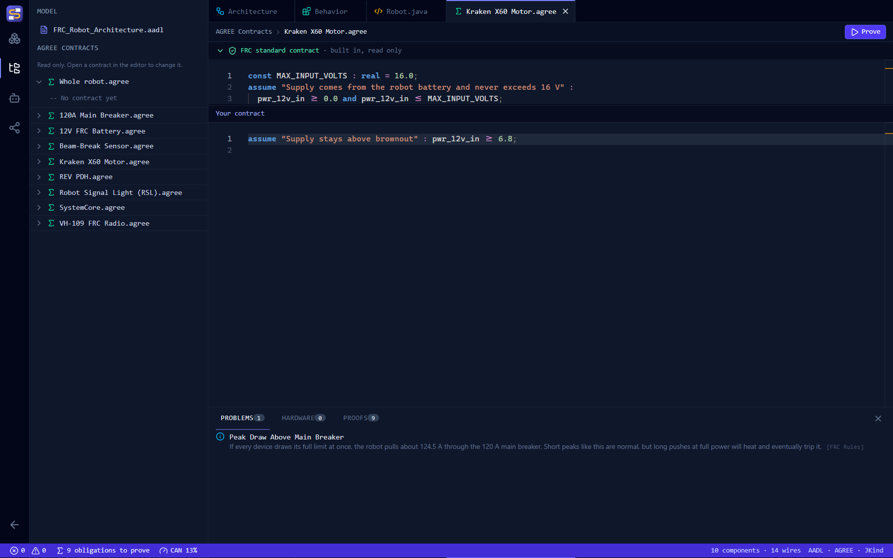
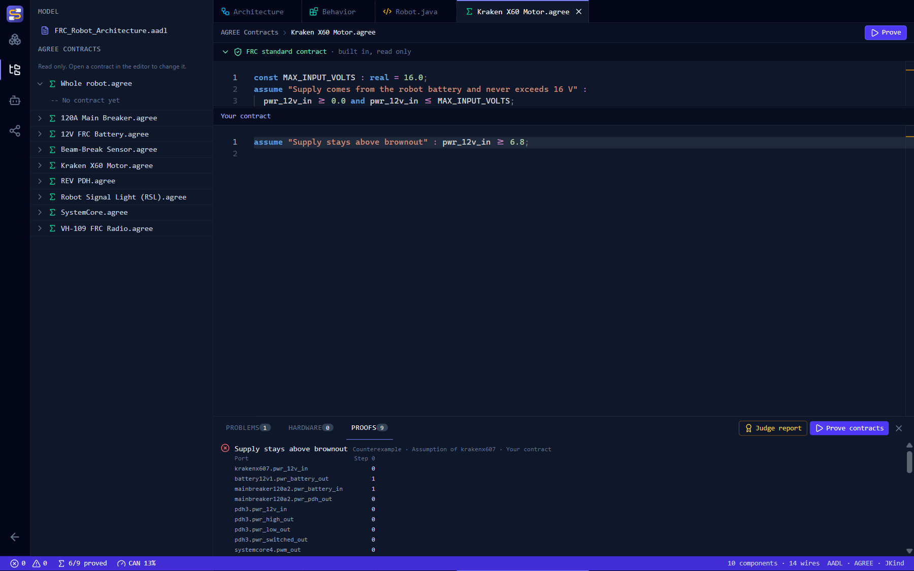

# AADL and AGREE for FRC

SysMod Studio turns your Architecture diagram into an AADL model with AGREE contracts already attached. The contracts encode FRC electrical rules and hardware limits. You can prove them with one click, and add your own contracts as your design grows.

## Finding your way around

The Architecture page is laid out like VS Code:

| Area | Where | What it holds |
|---|---|---|
| **Activity bar** | The icons on the far left | Switches the side bar between **Components**, **Model & Contracts**, and **Export & Project** |
| **Side bar** | Next to the activity bar | The component palette, a read-only explorer of the AADL model and every AGREE contract, or export buttons |
| **Editor** | The middle | Tabs for the **Architecture** diagram, the generated `FRC_Robot_Architecture.aadl`, and each `.agree` contract you open |
| **Panel** | Below the editor | **Problems** (FRC rule issues and AGREE errors) and **Proofs** (JKind results) |
| **Status bar** | The bottom edge | Error and warning counts and proof status. Select them to open the panel. |

Select the active activity bar icon again to hide the side bar. **Ctrl+B** toggles the side bar and **Ctrl+J** toggles the panel, as in VS Code. Drag the edge of the side bar or panel to resize it.

## Two kinds of checking

| | Problems | Proofs |
|---|---|---|
| **Checks** | How the robot is wired | How the robot behaves over time |
| **Example** | "The RSL must connect to the robot controller's RSL port." | "PWM outputs are always 0 during a brownout." |
| **How** | Instant checks on the diagram | A JKind proof over every possible input |
| **Runs** | Whenever the diagram changes | When you select **Prove** |

Start with Problems. A proof about a robot with missing wires tells you less than one about a correctly wired robot.

## How your diagram becomes a model

| On the diagram | In the AADL model |
|---|---|
| Each kind of component in the palette | A `device` type with one port per connection point |
| Each component you add | A subcomponent of `FRC_Robot.impl` |
| Each wire | A port connection |
| A CAN or Ethernet chain | A `bus`, with its connections bound to it |
| CAN IDs, DIO ports and PDH channels | Comments next to each subcomponent |

### What a wire carries

For contracts, each wire carries a value at every step in time:

| Wire | Value type | Meaning |
|---|---|---|
| Power (battery, PDH, VRM, MPM, buck) | `real` | Voltage, in volts |
| PWM | `real` | Duty cycle, from -1 to 1 |
| CAN, Ethernet, USB, I2C, MXP | `bool` | Whether the link is active |
| DIO, RSL | `bool` | Whether the signal is on |
| Compressor, solenoid, pressure switch | `bool` | Whether it is on, or for the switch, whether it is calling for air |

## The FRC standard contracts

These contracts are always included, and you can't edit them. They appear in the **Model & Contracts** side bar, and at the top of each contract's editor tab.

| Component | Contract | Why |
|---|---|---|
| 12V Battery | **Guarantee:** voltage stays between 0 V and 14.4 V | The robot may only be powered by its one 12 V lead-acid battery. 14.4 V is the most a lead-acid battery reaches while charging. |
| 120A Main Breaker | **Guarantee:** passes battery voltage through, or is tripped open (0 V) | All power passes through the main breaker. |
| REV PDH | **Guarantee:** every channel stays between 0 V and the PDH input | Fuses and breakers can only remove power, not add it. |
| Mini Power Module | **Guarantee:** outputs stay between 0 V and the module input | Same as the PDH. |
| VRM, buck converter | **Guarantee:** regulated output stays between 0 V and 12 V | These regulators output at most 12 V. |
| SystemCore | **Guarantee:** PWM outputs stay between -1 and 1 | The PWM duty cycle range. SystemCore's brownout guarantee will be added once FIRST publishes its threshold. |
| roboRIO 2.0 | **Guarantee:** PWM outputs stay between -1 and 1 | The PWM duty cycle range |
| roboRIO 2.0 | **Guarantee:** PWM outputs are 0 below 6.75 V | The roboRIO 2.0 disables PWM outputs during a brownout. 6.75 V is its default threshold. |
| Every powered device | **Assume:** supply stays between 0 V and 16 V | 16 V is the roboRIO 2.0 maximum input, the lowest maximum among common FRC control electronics. |
| PWM servo | **Assume:** PWM command stays between -1 and 1 | A servo needs a valid command. |
| Pneumatic Hub | **Guarantee:** the compressor only runs while the pressure switch calls for air | The compressor must stop when the switch reaches cutoff. |
| Whole robot | **Lemma:** each compressor stops when its pressure switch reaches cutoff | Added automatically when a compressor and pressure switch share a Pneumatic Hub. |

!!! warning
    The limits above come from hardware documentation and general FRC rules, and the brownout threshold can be changed in code. Check them against the current season's game manual and your hardware's datasheets. A proof is only as good as the contracts it uses.

## Writing your own contracts

1. Select **Model & Contracts** in the activity bar. Each component type on your diagram has a `.agree` file, plus `Whole robot.agree` for system lemmas. Expand one to read it.
2. Select the pencil next to a contract, or double-click it, to open it as a tab in the editor. The side bar is read only.
3. Write AGREE statements under **Your contract**. Mistakes are underlined as you type and listed in **Problems**. Select a problem to jump to its contract.
4. Select **Prove** in the editor, or **Prove contracts** in the **Proofs** panel.



A contract on a component type applies to **every** component of that type. Inside it, use that component's port names, such as `pwr_12v_in`. Port names match the AADL model, with `-` replaced by `_`.

In **Whole robot**, refer to a specific component by its id, a dot, then the port: `kraken6.pwr_12v_in`. The ids appear in each component's title on the canvas and in the AADL model.

### Examples

A motor that needs a healthy battery, on the Kraken X60:

```agree
assume "Supply stays above brownout" : pwr_12v_in >= 6.8;
```

A design rule for the whole robot:

```agree
lemma "Servo is idle during a brownout" :
  rio4.pwr_12v_in < 6.75 => servo7.pwm_in = 0.0;
```

The second example is proved from the roboRIO's standard brownout guarantee and the PWM wire. On a SystemCore robot it can't be proved yet, because SystemCore has no brownout guarantee until FIRST publishes its threshold.

A limit on how fast voltage can drop, using time:

```agree
lemma "Supply never drops more than 2 V in one step" :
  true -> (kraken6.pwr_12v_in >= pre(kraken6.pwr_12v_in) - 2.0);
```

This one fails, because nothing in the standard contracts limits how fast the battery voltage can change. The counterexample shows two steps where it drops sharply. A failed lemma like this tells you what your design is relying on that nobody has promised.

## Reading proof results

Each assumption and lemma gets a result:

- **Proved:** it holds for every possible input, at every step.
- **Counterexample:** it can fail. The table shows the port values at each step, starting at step 0, with the failing component's ports first.
- **Not proved in time:** JKind ran out of time. Simplify the contract, or try again.
- **Contracts contradict:** the contracts can't all be true at once, so nothing about the robot can be trusted until you fix them.

Here the Kraken example above fails. Nothing on the diagram promises the battery stays above 6.8 V, so JKind found a step where the motor's supply is 0 V:



A port with no wire into it can take **any** value. If a device's power input is not wired, its supply assumption fails. Fix the wiring first, using **Problems**.

Proof results go stale when you change the diagram or a contract. Prove again after each change.

To explain your results to judges, open the **Judge report**. It shows each proved property with a step-by-step proof in plain language. See [Showing judges your proofs](judge-report.md).

## Requirements

Proofs run [JKind](https://github.com/loonwerks/jkind) on your computer. The installed app includes JKind and the small Java runtime it needs, so **you don't need to install Java**.

Proofs only run in the SysMod Studio desktop app, not in a web browser.

### Running from source

A source checkout doesn't include JKind. To build it, install a JDK and run:

```bash
npm run build:jkind
```

It compiles JKind from source at a pinned version and builds a trimmed Java runtime into `sysmod-studio/resources/jkind/`. Compiling JKind needs JDK 11, because JKind's Gradle build doesn't run on newer JDKs. If you already have a `jkind.jar` in that folder, any JDK 11 or newer works. Then check it with:

```bash
npm run test:proofs
```

## Using OSATE and AGREE

The saved `.aadl` file includes every contract, so you can check it in OSATE with the AGREE plugin:

1. Install OSATE with AGREE. The [MATRICS setup script](https://github.com/loonwerks/MATRICS/blob/main/make_matrics.bat) installs OSATE 2.14 with the AGREE and Resolute plugins on Windows.
2. Create an AADL project and add the saved `.aadl` file.
3. Select `FRC_Robot.impl` and run **Verify All Layers** from the AGREE menu.

## Limits of the local checker

SysMod supports the parts of AGREE that FRC contracts need most. It does not yet support:

- AGREE `node` and `fun` definitions
- Records and enumerations
- `event()` on event ports. CAN and Ethernet values are treated as plain on/off values.
- Contracts on the whole-robot system type. Use lemmas in **Whole robot** instead.

A statement SysMod can't handle is reported as an error, never silently skipped.

Time in these proofs is a sequence of abstract steps, not seconds, and voltages are exact numbers, not measurements. A proof shows that your design is consistent with its contracts. It does not replace the FRC rules check, robot inspection or testing.
