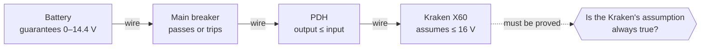
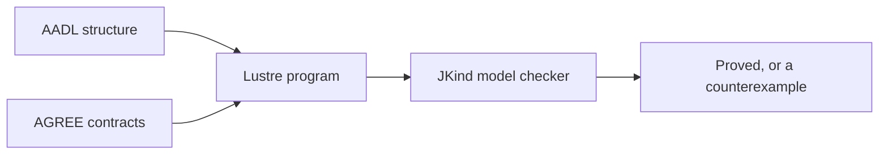

# How AADL and AGREE work together

AADL and AGREE answer two different questions about the same design:

| | AADL | AGREE |
|---|---|---|
| **Question** | What is the system made of, and how is it wired? | What does each part promise, and do the promises fit? |
| **Describes** | Structure | Behavior |
| **FRC example** | "The PDH's high-current output is wired to the Kraken's 12 V input." | "The PDH never outputs more than its input, and the Kraken needs at most 16 V." |

AGREE contracts live **inside** the AADL model as annexes. A contract on a component type applies to every part of that type, and a contract on the system implementation can talk about the parts inside it:

```aadl
device PDH
  features
    pwr_12v_in: in data port Electrical_Power;
    pwr_high_out: out data port Electrical_Power;
  annex agree {**
    guarantee "High-current channels never exceed the PDH input" :
      pwr_high_out >= 0.0 and pwr_high_out <= pwr_12v_in;
  **};
end PDH;

system implementation FRC_Robot.impl
  subcomponents
    pdh3: device PDH;
    kraken6: device KrakenX60;
  connections
    power_1: port pdh3.pwr_high_out -> kraken6.pwr_12v_in;
  annex agree {**
    lemma "Motor never browns out" : kraken6.pwr_12v_in >= 6.8;
  **};
end FRC_Robot.impl;
```

## Compositional proof

AGREE checks a design one level at a time. For the robot:

1. Each part's **guarantees** are taken as true, but only while that part's **assumptions** have always held.
2. The AADL **connections** link the parts, so a wire makes the input port equal the output port it is wired to.
3. JKind must **prove** every part's assumptions, plus every system lemma, from steps 1 and 2.



Here, the battery promises at most 14.4 V, the breaker passes it on or opens, and the PDH never adds voltage. So the Kraken always gets at most 14.4 V, and its 16 V assumption is proved.

The proof never looks inside the parts. It only uses their contracts, which keeps it fast on big designs. It also means a part can be swapped for any other part with a contract at least as strong, without proving everything again.

## From AADL and AGREE to a proof



OSATE with the AGREE plugin follows these steps. SysMod Studio follows the same steps on your own computer, without OSATE. See [AADL and AGREE for FRC](aadl-agree-for-frc.md).

Next: [AADL and AGREE for FRC](aadl-agree-for-frc.md)
