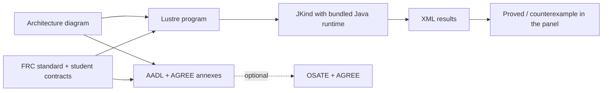

# How SysMod runs AADL + AGREE without OSATE

This page is for contributors. It explains how SysMod Studio proves AGREE contracts on a student's laptop without OSATE, Eclipse or a Java install.

## The problem

AGREE is distributed as Eclipse plugins for OSATE. The standard way to get it running is the [MATRICS setup script](https://github.com/loonwerks/MATRICS/blob/main/make_matrics.bat). It downloads OSATE 2.14 (an Eclipse application) and installs the latest AGREE and Resolute plugins into it. That is a large, Windows-specific install, and the plugin versions aren't pinned. It also needs a separate AADL editing workflow, which doesn't fit an app students already use.

## The key observation

Most of AGREE's work happens in two steps:

1. Translate the AADL model and its AGREE annexes into **Lustre**, a synchronous dataflow language.
2. Hand the Lustre to **[JKind](https://github.com/loonwerks/jkind)**, a standalone model checker, and report its answers.

JKind is an ordinary Java program with no Eclipse dependency, and it bundles its own SMT solver (SMTInterpol). So SysMod reimplements step 1 for its own models and calls JKind directly for step 2. OSATE isn't needed.



SysMod builds its model from the diagram, not by parsing AADL text. The diagram is the single source of truth. Both the AADL file and the Lustre program are generated from it, so they always describe the same robot.

## The pieces

| Step | File | What it does |
|---|---|---|
| Contracts | [`frcContracts.ts`](https://github.com/Suave101/SysMod/blob/main/sysmod-studio/src/renderer/src/views/utils/agree/frcContracts.ts) | Standard FRC contracts per device type, generated system lemmas, and merging in student contracts |
| Parse | [`agreeParser.ts`](https://github.com/Suave101/SysMod/blob/main/sysmod-studio/src/renderer/src/views/utils/agree/agreeParser.ts) | Hand-written lexer and recursive-descent parser for the AGREE subset; recovers after errors so one bad line doesn't hide the rest |
| Translate | [`lustreGenerator.ts`](https://github.com/Suave101/SysMod/blob/main/sysmod-studio/src/renderer/src/views/utils/agree/lustreGenerator.ts) | Diagram + contracts to one Lustre program, with a table that maps each Lustre property back to its contract |
| Run | [`jkind.ts`](https://github.com/Suave101/SysMod/blob/main/sysmod-studio/src/main/jkind.ts) | Electron main process: writes the `.lus` to a temp folder and runs `java -jar jkind.jar -jkind -xml_to_stdout` |
| Read results | [`jkindResults.ts`](https://github.com/Suave101/SysMod/blob/main/sysmod-studio/src/renderer/src/views/utils/agree/jkindResults.ts) | Parses JKind's XML, including rational reals such as `13/2`, and splits signals back into device and port |
| AADL | [`aadlGenerator.ts`](https://github.com/Suave101/SysMod/blob/main/sysmod-studio/src/renderer/src/views/utils/aadlGenerator.ts) | Writes the same contracts as `annex agree {** ... **}` blocks, so OSATE can check the identical model |

## How the translation works

SysMod follows AGREE's compositional check of one system implementation.

- **Ports become streams.** Every device port becomes a Lustre variable named `<device>__<port>`, such as `pdh3__pwr_high_out`. Power and PWM ports are `real`. Digital and network ports are `bool`.
- **Wires become equations.** An input with exactly one wire is defined as its source, for example `kraken6__pwr_12v_in = pdh3__pwr_high_out;`. Inputs with no wire stay free inputs, which the model checker may set to any value.
- **Guarantees are assumed, conditionally.** Each device's guarantees are asserted only while its own assumptions have always held: `assert historically(<assumptions>) => <guarantee>;`. A small `historically` node implements "has always been true".
- **Assumptions and lemmas are proved.** Each device assumption and each system lemma becomes a `--%PROPERTY` for JKind to prove.
- **Names are kept unique.** Device-type constants become `<Type>__<NAME>`, and each `eq` is created once per device instance.
- **Time maps directly.** `pre`, `->`, `if/then/else` and the arithmetic and logic operators map one-to-one. `prev(x, i)` becomes `(i -> pre (x))`, and `<=>` becomes `=`.

Here is an excerpt of what a Kraken fed from the PDH produces:

```lustre
kraken6__pwr_12v_in = pdh3__pwr_high_out;
pdh3__guarantee_0 = ((pdh3__pwr_high_out >= 0.0) and (pdh3__pwr_high_out <= pdh3__pwr_12v_in));
kraken6__assume_1 = ((kraken6__pwr_12v_in >= 0.0) and (kraken6__pwr_12v_in <= KrakenX60__MAX_INPUT_VOLTS));
assert historically(pdh3__assume_4) => pdh3__guarantee_0;
--%PROPERTY kraken6__assume_1;
```

## Keeping OSATE compatible

The generated `.aadl` file can still be checked by real AGREE:

- `with Base_Types;` is imported, and every wire data type extends `Base_Types::Float` or `Base_Types::Boolean`. AGREE needs typed ports to reason about their values.
- Device contracts are written as annexes on the device types, and system lemmas as an annex on `FRC_Robot.impl`. That is where OSATE's AGREE expects them.
- Each annex block is labelled `-- FRC standard contract` or `-- Your contract`.

## Removing the Java requirement

JKind is Java bytecode compiled for Java 11. Instead of asking students to install Java, [`build-jkind.mjs`](https://github.com/Suave101/SysMod/blob/main/sysmod-studio/scripts/build-jkind.mjs) does three things:

1. Compiles JKind from source at a pinned tag (`v4.5.2`) with JDK 11, because JKind's Gradle 7.2 build doesn't run on newer JDKs.
2. Runs `jdeps` to find the modules JKind uses (`java.base`, `java.compiler`, `java.desktop`). Then it runs `jlink` to build a trimmed Java runtime of about 45 MB containing only those modules.
3. Proves a small Lustre file with that runtime as a smoke test.

The jar and the runtime go in `sysmod-studio/resources/jkind/`, which electron-builder ships unpacked. The runner tries the bundled runtime first, then `JAVA_HOME`, then `java` on the PATH. CI builds the runtime separately on each OS, because it is platform specific, and runs `npm run test:proofs` before packaging.

## How it was checked

- JKind accepted the generated Lustre unchanged and gave the expected answers. A correct power chain was proved. Lowering the battery minimum gave a counterexample showing the motor supply below brownout.
- `npm run test:proofs` proves all 9 standard obligations on a fully wired robot. It confirms that unpowering the roboRIO makes the servo's assumption fail, and that a student lemma is proved from the standard contracts.
- Clicking **Prove contracts** in the real Electron window ran through IPC to the bundled JKind and showed results and a counterexample table.
- The proof tests also passed with no Java on the PATH and no `JAVA_HOME`.

## Differences from real AGREE

- **Not yet compared with OSATE.** No one has run the same `.aadl` through OSATE + AGREE to confirm the answers match. That is the most important check still to do.
- **AGREE subset only.** `node`, `fun`, records, enumerations, `event()`, `initially`, synchrony and calendar specs, and contracts on the top-level system type are rejected with an error, never ignored.
- **One level only.** SysMod checks the single robot implementation. AGREE can also verify nested implementations layer by layer.
- **No extra analyses.** AGREE's realizability checks, inductive validity cores and contract consistency checks aren't wired up. JKind supports some of these (`-ivc`, `jrealizability`), so they are natural next steps.
- **Fan-in wires.** An input port with more than one wire is left unconstrained, with a warning, instead of being modelled.
