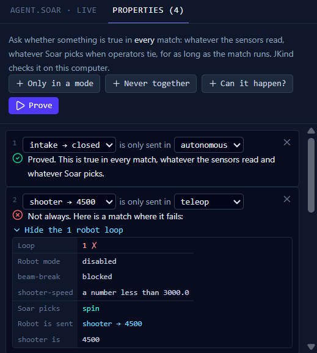

# Proving facts about robot behavior

SysMod can prove facts about the Soar agent you build from behavior blocks, such as "the intake only closes in autonomous". It turns the agent into an AADL component with an AGREE contract, then asks JKind, the same checker that proves the electrical design, whether each fact holds in **every** possible match.

This page explains what you can ask, what the answers mean, and how the agent becomes AGREE. [How SysMod models a Soar agent](soar-semantics.md) describes the behavior the model follows, and how it is tested against real Soar.

## In the app

1. Build the agent in the **Behavior** tab.
2. In the right-hand pane, choose **Properties**.
3. Add a property with **Only in a mode**, **Never together** or **Can it happen?**, and pick the commands and mode from the lists. The lists show every command your rules send.
4. Choose **Prove**. JKind runs on your computer, usually in a few seconds.
5. When an answer comes with an example, choose **Show the robot loops** to see the match, one column per loop: the robot mode, each reading, what Soar picked, and what the robot was sent.

If you change the blocks or a property, the old answers are marked out of date until you prove again. Warnings about the blocks, such as two required operators that can stall the agent, appear in **Problems**. The model itself is in **Soar_Agent.aadl**, under Behavior in the side bar.

The properties are kept while the app is open. Like the diagram, they aren't saved to disk yet.

## What you can ask

| Template | Example | A good answer |
|---|---|---|
| **Only in mode** | The intake is set to `closed` only in autonomous | **Valid**: it can't happen in any other mode |
| **Never together** | The intake is never `closed` while the shooter is `4500` | **Valid**: no run of the agent reaches that state |
| **Can it happen?** | Can the LED be set to `green`? | **Falsifiable**: yes, and the counterexample shows how |

"Never together" is about the **last** value each device was sent, which is what the robot is doing. "Only in mode" and "Can it happen?" are about the loop the command is sent in.

In an example, a ✗ marks the loop where the property fails. For "Can it happen?", **← here** marks the loop where the command is sent.

"Can it happen?" works backwards. SysMod asks JKind to prove that the command is **never** sent. If that is false, JKind finds a run that sends it, which answers the question. If it is valid, the command can never be sent, which usually means a rule can't match.

## What "every possible match" covers

A proof covers all of these at once:

- **Every reading the robot can send.** SysMod takes these from the diagram (see the table below). A reading can also be missing for a loop. A name that isn't on the diagram can be any number, any word, or nothing.
- **Every choice Soar makes.** When equal operators tie, Soar picks at random. A proof holds for every pick.
- **Every order.** When one loop sends a device two values, the proof covers either one running last.
- **Any number of loops.** JKind proves the fact for the whole match, not just the first few seconds.

The proof assumes two things about the robot, both true of the generated Robot.java and robot.py:

- It sends one of its four modes (`disabled`, `autonomous`, `teleop`, `test`) every loop.
- Each device and subsystem on the diagram only sends the values below.

| On the diagram | What the proof lets it send |
|---|---|
| Beam break | `blocked` or `clear` |
| Limit switch | `pressed` or `released` |
| Solenoid, compressor, PhotonVision | `true` or `false` |
| Motor, encoder, gyro, servo, Limelight | Any number |
| A subsystem | `none`, or a word your rules set it to |
| A device with no reading, such as the PDH | Nothing |

A subsystem your rules set to a number is left open, because the exact word the robot reports for a number isn't fixed yet.

If a rule tests a reading against a value its device never sends, such as a beam break equal to `jammed`, **Problems** warns you. That rule can never match.

## How the agent becomes AGREE

The generated AADL has one component, `Soar_Agent`. One AGREE step is one robot loop.

| Soar | AGREE |
|---|---|
| A reading, such as `beam-break` | Two integer inputs, a **kind** (not sent, a number or a word) and a **code** |
| A test, such as "beam-break equals blocked" | An integer comparison on the code |
| An operator, such as `hold` | A constant, `op_hold`, and an `eq` for when it is proposed |
| The operator Soar selects | `eq winner` and `eq selected` |
| A tie between equal operators | A free input, `tie` |
| A command value, such as intake `closed` | A constant, `cmd_intake_closed` |
| What the robot was last told | `eq last_intake` |
| A property | A `guarantee` |

### Readings as codes

A model checker can't reason about "any word". SysMod doesn't need it to. A rule only cares how a reading compares with the constants the rules test it against. So each reading becomes a **code**:

| Code | Means, for a speed tested against 3000.0 and 4500.0 |
|---|---|
| 0 | less than 3000.0 |
| 1 | equal to 3000.0 |
| 2 | between 3000.0 and 4500.0 |
| 3 | equal to 4500.0 |
| 4 | greater than 4500.0 |

Odd codes are the constants; even codes are the gaps between them. Words work the same way, in dictionary order. Every test then gives the same answer Soar would, so nothing is lost.

One more input, `<reading>_changes`, says whether a reading changed within its gap, for example 3500 to 3600. Soar sees that as a new value, so rules that matched it fire again.

### Equations for one decision

The rest of the contract is `eq` statements that follow the decision step by step: which operators are proposed, whether the clear operator must run, which operator wins, which apply rules fire, and which commands go out. Comments in the generated AADL name each operator and say when it is proposed, in the words you used in the blocks.

The proof is about exactly this text. SysMod reads the annex with its own AGREE parser and compiles it to Lustre for JKind, the same way it proves device contracts.

## How it is checked

| Check | What it shows |
|---|---|
| The equations, run loop by loop beside the simulator on 300 random programs (36,000 loops) | The AGREE model does what the simulator does |
| The simulator against real Soar 9.6.5 ([details](soar-semantics.md#how-it-is-checked)) | The simulator does what Soar does |
| JKind on a test program, with known answers | Each template gives the right answer |
| A JKind counterexample, replayed through the equations | JKind and SysMod read the equations the same way |
| 100 more random programs, with random readings tied to devices | Tying readings to the diagram keeps the model faithful |
| JKind on rules that need a reading the device never sends | Those commands can happen without the diagram, and can't with it |

To find out whether these checks could catch a bug, we planted small mistakes in the translation, one at a time. Each was caught. The rarest one only shows up with a required operator whose apply rule tests a reading. A fixed test program covers that case.

## Limits

- **Not loaded in OSATE yet.** The annex uses only standard AGREE, but it has only been checked with SysMod's parser and JKind.
- **The robot is assumed to finish each command within a loop**, as in [the model](soar-semantics.md#not-in-the-model).
- **The readings are only as right as the diagram.** If a device on the diagram isn't the one on the robot, or its code sends something else, the proof's assumption about it is wrong. Names that aren't on the diagram are left open, so they can't cause this.
- **Probabilities** ("how often does this happen?") come later, with PRISM.
